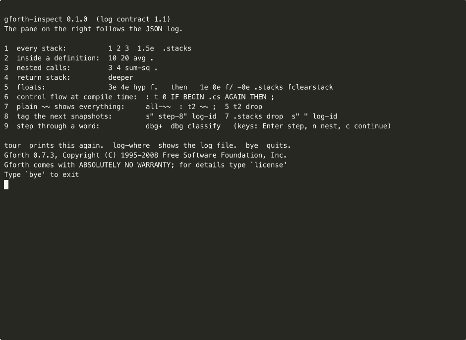

#+TITLE: gforth-inspect
#+STARTUP: showall

[[file:LICENSE][https://img.shields.io/badge/license-GPLv3%2B-blue.svg]] [[https://gforth.org/][https://img.shields.io/badge/gforth-0.7.3%20%C2%B7%20fast%20%C2%B7%20itc-informational.svg]]

A stack inspector for gforth 0.7.3.

* Install

Download =inspect.fs= from the release and load it:

#+begin_src sh
curl -fsSLO https://github.com/jwalsh/gforth-inspect/releases/download/v0.3.1/inspect.fs
gforth inspect.fs
#+end_src

It needs a 64-bit gforth 0.7.3. =inspect-version type= prints 0.3.1.

With [[https://github.com/VitaSound/fmix][fmix]] (0.9.0 or earlier for gforth 0.7.3), add to =package.4th=:

#+begin_example
key-list dependencies gforth-inspect git https://github.com/jwalsh/gforth-inspect tag v0.3.1
#+end_example

then =fmix packages.get= and
=require ./forth-packages/gforth-inspect/v0.3.1/env/inspect.fs=.

* Usage

| word              | does                                                         |
|-------------------+--------------------------------------------------------------|
| =.stacks=         | prints every stack and the input line                        |
| =.rs=             | the return stack, top first; =rs-full on= adds interpreter frames |
| =.input=          | file:line, =>IN=, and the current line with a caret            |
| =.cs=             | (immediate, inside a definition) the control-flow stack      |
| =~~~=             | =~~= that prints every stack                                   |
| =all-~~=          | plain =~~= then does what =~~~= does                             |
| =dbg-fix=         | stock =dbg= in every engine, =n= (nest) included                 |
| =dbg+=            | =dbg-fix=, plus the stacks at each step                        |
| =log-on= / =log-off= | stream each snapshot to a log / stop                      |
| =log-where=       | prints the log's path                                        |
| =s" x" log-id=    | tags the next snapshots with =x=                               |
| =fclearstack=     | empties the float stack                                      |
| =inspect-version= | ( -- c-addr u ) the loaded version                           |

Every word's stack effect and output format: =WORDS.org=, shipped with each
release.

** Every stack at once

#+begin_example
$ gforth inspect.fs -e '1 2 3 1.5e .stacks bye'
data   <3> 1 2 3
float  <1> 1.500000000000E0
return <R:27> top first
  ... interpreter (rs-full on to see it)
input  *OS command line*:-1 >in=19
1 2 3 1.5e .stacks bye
                   ^
#+end_example

Identical in =gforth-fast= and =gforth-itc=.

** Inside a definition

#+begin_example
$ cat demo.fs
: avg ( n1 n2 -- n3 )  + ~~~ 2/ ;
10 20 avg .
$ gforth inspect.fs demo.fs -e bye
demo.fs:1 in avg
data   <1> 30
float  <0>
return <R:40> top first
  ... interpreter (rs-full on to see it)
input  demo.fs:2 >in=10
10 20 avg .
          ^
15
#+end_example

** Stepping

Each =->= waits for a key.

#+begin_example
$ cat avg.fs
: avg ( n1 n2 -- n3 )  + 2/ ;
$ gforth inspect.fs avg.fs -e 'dbg+ 10 20 dbg avg . cr bye'
: avg
Scanning code...

Nesting debugger ready!

D: <2> 10 20  F: <0> R: -
13B0492D0 102246604 +              ->
D: <1> 30  F: <0> R: -
13B0492D8 102247168 2/             ->
D: <1> 15  F: <0> R: -
13B0492E0 102244A64 ;              -> 15
#+end_example

Addresses differ per run. In =gforth-fast=, =dbg= skips the steps that
engine fuses into superinstructions.

** Logging

#+begin_example
$ GFORTH_INSPECT_LOG_DIR=logs gforth inspect.fs -e 'log-on 1 2 -3 1.5e .stacks log-off bye' >/dev/null
$ cat logs/stacks.jsonl
{"v":1,"event":"hello","t":1795384752,"gforth":"0.7.3","inspect":"0.4.0","contract":"1.2"}
{"v":1,"event":"snapshot","t":1795384752,"where":null,"src":null,"data":[1,2,-3],"float":[1.5000000000000000E0 ],"rs":[],"input":{"file":"*OS command line*","line":-1,"in":27,"text":"log-on 1 2 -3 1.5e .stacks log-off bye"}}
#+end_example

Without =GFORTH_INSPECT_LOG_DIR=, each project and branch gets its own log
under =${XDG_STATE_HOME:-~/.local/state}/gforth-inspect/=, one directory
per owner, repository and branch, each name encoded as one path component
(branch =feat/x= becomes =feat-x~= and 12 hex digits); =log-where= prints
the path, so don't build it by hand. A =GFORTH_INSPECT_LOG_DIR== line in
the project's =.env= sets it instead. The fields
are defined in =stacks-log.schema.json=, shipped with each release. A float
that is not finite is logged as the string ="NaN"=, ="Infinity"= or
="-Infinity"=.

* Licence

GPL-3.0-or-later. See [[file:LICENSE][LICENSE]].
